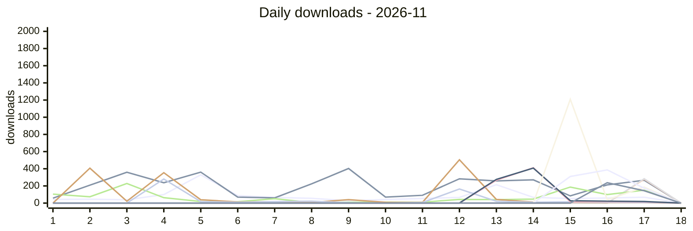
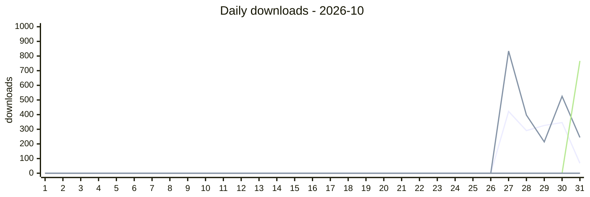

# NPM Downloads Tracker

Daily download counts for watched npm packages, fetched daily at 16:10 UTC (00:10 Beijing time) by GitHub Actions.
Days roll over at midnight Beijing time (UTC+8); npm per-day counts are UTC-day buckets, so the "today" row may stay 0 until the UTC day starts.

_Last updated: 2026-11-18 12:20 UTC_

## Watched packages

- `dsh-loop-recover`
- `dsh-rss-news-daily`
- `dsh-rss-news-flash-kuaixun`
- `dsh-rss-news-browser-fetch`
- `opencode-loop-recover`
- `oc-market-quail-zephyr-72a0`
- `awesome-opencode-market`
- `surfbird`
- `surfbird-mcp`
- `dsh-control-surfbird-for-kitesurf`
- `opencode-control-surfbird-for-kitesurf`
- `pi-control-surfbird-for-kitesurf`

## 2026-11 — month to date

| Package | Total | Est. real | Avg/day | Peak | Today | Trend |
| --- | ---: | ---: | ---: | ---: | ---: | ---: |
| `dsh-loop-recover` | 1,417 | 967 | 78.7 | 329 · 11-05 | 0 | ▂▂▁▃█▃▂▂▁▂▂▂▆▂▂▂▂▁ |
| `dsh-rss-news-daily` | 3,517 | 1,417 | 195.4 | 403 · 11-09 | 0 | ▂▅█▅█▂▂▅█▂▂▆▆▆▂▅▆▁ |
| `dsh-rss-news-flash-kuaixun` | 279 | 0 | 15.5 | 279 · 11-17 | 0 | ▁▁▁▁▁▁▁▁▁▁▁▁▁▁▁▁█▁ |
| `dsh-rss-news-browser-fetch` | 284 | 0 | 15.8 | 284 · 11-17 | 0 | ▁▁▁▁▁▁▁▁▁▁▁▁▁▁▁▁█▁ |
| `opencode-loop-recover` | 1,163 | 863 | 64.6 | 228 · 11-03 | 0 | ▄▃█▃▁▁▂▁▁▁▁▂▂▂▇▄▆▁ |
| `oc-market-quail-zephyr-72a0` | 1,498 | 341 | 83.2 | 505 · 11-12 | 0 | ▁▇▁▆▁▁▁▁▁▁▁█▁▁▁▁▁▁ |
| `awesome-opencode-market` | 584 | 154 | 32.4 | 280 · 11-04 | 0 | ▁▁▁█▁▁▁▁▁▁▁▅▁▁▁▁▁▁ |
| `surfbird` | 729 | 162 | 40.5 | 412 · 11-14 | 0 | ▁▁▁▁▁▁▁▁▁▁▁▁▆█▁▁▁▁ |
| `surfbird-mcp` | 753 | 177 | 41.8 | 408 · 11-14 | 0 | ▁▁▁▁▁▁▁▁▁▁▁▁▆█▁▁▁▁ |
| `dsh-control-surfbird-for-kitesurf` | 1,434 | 234 | 79.7 | 1,209 · 11-15 | 0 | ▁▁▁▁▁▁▁▁▁▁▁▁▁▁█▁▂▁ |
| `opencode-control-surfbird-for-kitesurf` | 870 | 120 | 48.3 | 387 · 11-16 | 0 | ▁▁▁▁▁▁▁▁▁▁▁▁▁▁▇█▄▁ |
| `pi-control-surfbird-for-kitesurf` | 382 | 0 | 21.2 | 238 · 11-16 | 0 | ▁▁▁▁▁▁▁▁▁▁▁▁▁▁▁█▅▁ |

> `Est. real` subtracts ~150 automated downloads per version published that day — every `npm publish` triggers a scanner/mirror fetch wave. It's an upper bound on organic installs (ambient crawlers and CI can't be separated).

### Daily — 2026-11

| Package | **2026-11-18** | 2026-11-17 | 2026-11-16 | 2026-11-15 | 2026-11-14 | 2026-11-13 | 2026-11-12 | 2026-11-11 | 2026-11-10 | 2026-11-09 | 2026-11-08 | 2026-11-07 | 2026-11-06 | 2026-11-05 | 2026-11-04 | 2026-11-03 | 2026-11-02 | 2026-11-01 |
| --- | ---: | ---: | ---: | ---: | ---: | ---: | ---: | ---: | ---: | ---: | ---: | ---: | ---: | ---: | ---: | ---: | ---: | ---: |
| `dsh-loop-recover` | 0 | 69 | 59 | 53 | 67 | 214 | 66 | 54 | 42 | 27 | 56 | 66 | 88 | 329 | 99 | 39 | 46 | 43 |
| `dsh-rss-news-daily` | 0 | 266 | 212 | 84 | 271 | 258 | 283 | 91 | 70 | 403 | 224 | 61 | 70 | 361 | 237 | 359 | 209 | 58 |
| `dsh-rss-news-flash-kuaixun` | 0 | 279 | 0 | 0 | 0 | 0 | 0 | 0 | 0 | 0 | 0 | 0 | 0 | 0 | 0 | 0 | 0 | 0 |
| `dsh-rss-news-browser-fetch` | 0 | 284 | 0 | 0 | 0 | 0 | 0 | 0 | 0 | 0 | 0 | 0 | 0 | 0 | 0 | 0 | 0 | 0 |
| `opencode-loop-recover` | 0 | 151 | 100 | 187 | 47 | 41 | 43 | 10 | 11 | 10 | 6 | 52 | 16 | 19 | 63 | 228 | 74 | 105 |
| `oc-market-quail-zephyr-72a0` | 0 | 5 | 6 | 11 | 12 | 43 | 505 | 8 | 10 | 40 | 7 | 15 | 14 | 39 | 354 | 22 | 407 | 0 |
| `awesome-opencode-market` | 0 | 7 | 10 | 15 | 10 | 21 | 164 | 7 | 1 | 4 | 22 | 17 | 9 | 17 | 280 | 0 | 0 | 0 |
| `surfbird` | 0 | 15 | 19 | 16 | 412 | 267 | 0 | 0 | 0 | 0 | 0 | 0 | 0 | 0 | 0 | 0 | 0 | 0 |
| `surfbird-mcp` | 0 | 18 | 23 | 28 | 408 | 276 | 0 | 0 | 0 | 0 | 0 | 0 | 0 | 0 | 0 | 0 | 0 | 0 |
| `dsh-control-surfbird-for-kitesurf` | 0 | 186 | 39 | 1,209 | 0 | 0 | 0 | 0 | 0 | 0 | 0 | 0 | 0 | 0 | 0 | 0 | 0 | 0 |
| `opencode-control-surfbird-for-kitesurf` | 0 | 173 | 387 | 310 | 0 | 0 | 0 | 0 | 0 | 0 | 0 | 0 | 0 | 0 | 0 | 0 | 0 | 0 |
| `pi-control-surfbird-for-kitesurf` | 0 | 144 | 238 | 0 | 0 | 0 | 0 | 0 | 0 | 0 | 0 | 0 | 0 | 0 | 0 | 0 | 0 | 0 |
| **Total** | 0 | 1,597 | 1,093 | 1,913 | 1,227 | 1,120 | 1,061 | 170 | 134 | 484 | 315 | 211 | 197 | 765 | 1,033 | 648 | 736 | 206 |
| Est. real | 0 | 440 | 405 | 413 | 477 | 277 | 311 | 170 | 134 | 184 | 165 | 211 | 197 | 165 | 303 | 198 | 179 | 206 |

## Docker Hub pulls

| Image | All-time pulls | 2026-11 est. | Today | Trend |
| --- | ---: | ---: | ---: | ---: |
| `terry2010/surfbird` | 691 | 691 | 4 | ▁▁▁▁▁▁▁▁▁▁▁▁██▂▁▁▁ |

> Docker Hub only exposes a cumulative `pull_count` — daily figures are diffs between once-a-day snapshots, so they lag ~1 day. `≈` marks days inside a missed-run gap or a new repo’s pre-tracking baseline (delta spread evenly). Same bot-wave caveat as npm: new tags get pulled by image scanners.

### Daily pulls — 2026-11

| Image | **2026-11-18** | 2026-11-17 | 2026-11-16 | 2026-11-15 | 2026-11-14 | 2026-11-13 | 2026-11-12 | 2026-11-11 | 2026-11-10 | 2026-11-09 | 2026-11-08 | 2026-11-07 | 2026-11-06 | 2026-11-05 | 2026-11-04 | 2026-11-03 | 2026-11-02 | 2026-11-01 |
| --- | ---: | ---: | ---: | ---: | ---: | ---: | ---: | ---: | ---: | ---: | ---: | ---: | ---: | ---: | ---: | ---: | ---: | ---: |
| `terry2010/surfbird` | 4 | 12 | 29 | 67 | ≈289 | ≈290 | — | — | — | — | — | — | — | — | — | — | — | — |
| **Total** | 4 | 12 | 29 | 67 | 289 | 290 | — | — | — | — | — | — | — | — | — | — | — | — |

## Monthly history

| Month | `dsh-loop-recover` | `dsh-rss-news-daily` | `dsh-rss-news-flash-kuaixun` | `dsh-rss-news-browser-fetch` | `opencode-loop-recover` | `oc-market-quail-zephyr-72a0` | `awesome-opencode-market` | `surfbird` | `surfbird-mcp` | `dsh-control-surfbird-for-kitesurf` | `opencode-control-surfbird-for-kitesurf` | `pi-control-surfbird-for-kitesurf` | Grand total | Est. real |
| --- | ---: | ---: | ---: | ---: | ---: | ---: | ---: | ---: | ---: | ---: | ---: | ---: | ---: | ---: |
| 2026-10 | 1,453 | 2,214 | 0 | 0 | 767 | 0 | 0 | 0 | 0 | 0 | 0 | 0 | 4,434 | 487 |
| 2026-11 (MTD) | 1,417 | 3,517 | 279 | 284 | 1,163 | 1,498 | 584 | 729 | 753 | 1,434 | 870 | 382 | 12,910 | 4,435 |

Daily downloads — 2026-10

| Package | 2026-10-31 | 2026-10-30 | 2026-10-29 | 2026-10-28 | 2026-10-27 | 2026-10-26 | 2026-10-25 | 2026-10-24 | 2026-10-23 | 2026-10-22 | 2026-10-21 | 2026-10-20 | 2026-10-19 | 2026-10-18 | 2026-10-17 | 2026-10-16 | 2026-10-15 | 2026-10-14 | 2026-10-13 | 2026-10-12 | 2026-10-11 | 2026-10-10 | 2026-10-09 | 2026-10-08 | 2026-10-07 | 2026-10-06 | 2026-10-05 | 2026-10-04 | 2026-10-03 | 2026-10-02 | 2026-10-01 |
| --- | ---: | ---: | ---: | ---: | ---: | ---: | ---: | ---: | ---: | ---: | ---: | ---: | ---: | ---: | ---: | ---: | ---: | ---: | ---: | ---: | ---: | ---: | ---: | ---: | ---: | ---: | ---: | ---: | ---: | ---: | ---: |
| `dsh-loop-recover` | 68 | 346 | 326 | 291 | 422 | 0 | 0 | 0 | 0 | 0 | 0 | 0 | 0 | 0 | 0 | 0 | 0 | 0 | 0 | 0 | 0 | 0 | 0 | 0 | 0 | 0 | 0 | 0 | 0 | 0 | 0 |
| `dsh-rss-news-daily` | 244 | 525 | 214 | 397 | 834 | 0 | 0 | 0 | 0 | 0 | 0 | 0 | 0 | 0 | 0 | 0 | 0 | 0 | 0 | 0 | 0 | 0 | 0 | 0 | 0 | 0 | 0 | 0 | 0 | 0 | 0 |
| `dsh-rss-news-flash-kuaixun` | 0 | 0 | 0 | 0 | 0 | 0 | 0 | 0 | 0 | 0 | 0 | 0 | 0 | 0 | 0 | 0 | 0 | 0 | 0 | 0 | 0 | 0 | 0 | 0 | 0 | 0 | 0 | 0 | 0 | 0 | 0 |
| `dsh-rss-news-browser-fetch` | 0 | 0 | 0 | 0 | 0 | 0 | 0 | 0 | 0 | 0 | 0 | 0 | 0 | 0 | 0 | 0 | 0 | 0 | 0 | 0 | 0 | 0 | 0 | 0 | 0 | 0 | 0 | 0 | 0 | 0 | 0 |
| `opencode-loop-recover` | 767 | 0 | 0 | 0 | 0 | 0 | 0 | 0 | 0 | 0 | 0 | 0 | 0 | 0 | 0 | 0 | 0 | 0 | 0 | 0 | 0 | 0 | 0 | 0 | 0 | 0 | 0 | 0 | 0 | 0 | 0 |
| `oc-market-quail-zephyr-72a0` | 0 | 0 | 0 | 0 | 0 | 0 | 0 | 0 | 0 | 0 | 0 | 0 | 0 | 0 | 0 | 0 | 0 | 0 | 0 | 0 | 0 | 0 | 0 | 0 | 0 | 0 | 0 | 0 | 0 | 0 | 0 |
| `awesome-opencode-market` | 0 | 0 | 0 | 0 | 0 | 0 | 0 | 0 | 0 | 0 | 0 | 0 | 0 | 0 | 0 | 0 | 0 | 0 | 0 | 0 | 0 | 0 | 0 | 0 | 0 | 0 | 0 | 0 | 0 | 0 | 0 |
| `surfbird` | 0 | 0 | 0 | 0 | 0 | 0 | 0 | 0 | 0 | 0 | 0 | 0 | 0 | 0 | 0 | 0 | 0 | 0 | 0 | 0 | 0 | 0 | 0 | 0 | 0 | 0 | 0 | 0 | 0 | 0 | 0 |
| `surfbird-mcp` | 0 | 0 | 0 | 0 | 0 | 0 | 0 | 0 | 0 | 0 | 0 | 0 | 0 | 0 | 0 | 0 | 0 | 0 | 0 | 0 | 0 | 0 | 0 | 0 | 0 | 0 | 0 | 0 | 0 | 0 | 0 |
| `dsh-control-surfbird-for-kitesurf` | 0 | 0 | 0 | 0 | 0 | 0 | 0 | 0 | 0 | 0 | 0 | 0 | 0 | 0 | 0 | 0 | 0 | 0 | 0 | 0 | 0 | 0 | 0 | 0 | 0 | 0 | 0 | 0 | 0 | 0 | 0 |
| `opencode-control-surfbird-for-kitesurf` | 0 | 0 | 0 | 0 | 0 | 0 | 0 | 0 | 0 | 0 | 0 | 0 | 0 | 0 | 0 | 0 | 0 | 0 | 0 | 0 | 0 | 0 | 0 | 0 | 0 | 0 | 0 | 0 | 0 | 0 | 0 |
| `pi-control-surfbird-for-kitesurf` | 0 | 0 | 0 | 0 | 0 | 0 | 0 | 0 | 0 | 0 | 0 | 0 | 0 | 0 | 0 | 0 | 0 | 0 | 0 | 0 | 0 | 0 | 0 | 0 | 0 | 0 | 0 | 0 | 0 | 0 | 0 |
| **Total** | 1,079 | 871 | 540 | 688 | 1,256 | 0 | 0 | 0 | 0 | 0 | 0 | 0 | 0 | 0 | 0 | 0 | 0 | 0 | 0 | 0 | 0 | 0 | 0 | 0 | 0 | 0 | 0 | 0 | 0 | 0 | 0 |
| Est. real | 179 | 121 | 90 | 97 | 0 | 0 | 0 | 0 | 0 | 0 | 0 | 0 | 0 | 0 | 0 | 0 | 0 | 0 | 0 | 0 | 0 | 0 | 0 | 0 | 0 | 0 | 0 | 0 | 0 | 0 | 0 |

---

_Generated by `scripts/update.mjs` — raw data in `data/`_
