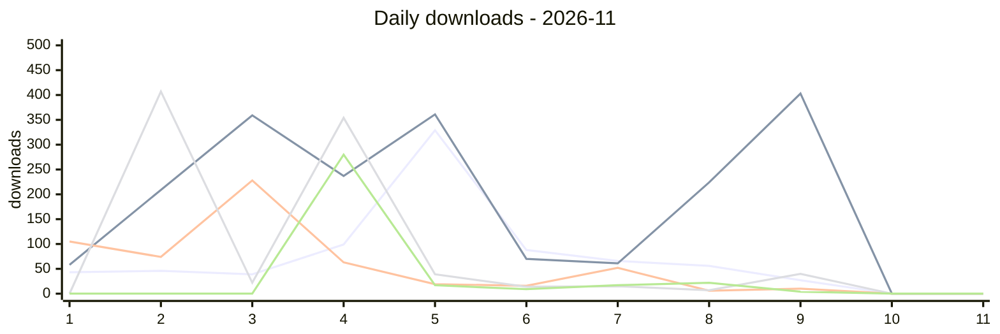
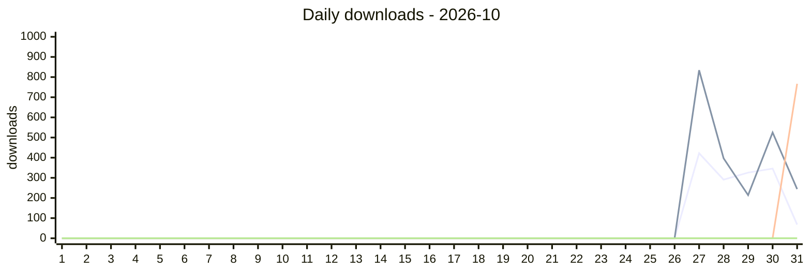

# NPM Downloads Tracker

Daily download counts for watched npm packages, fetched every morning (00:00 UTC / 08:00 Beijing time) by GitHub Actions.

_Last updated: 2026-11-11 03:44 UTC_

## Watched packages

- `dsh-loop-recover`
- `dsh-rss-news-daily`
- `opencode-loop-recover`
- `oc-market-quail-zephyr-72a0`
- `awesome-opencode-market`

## 2026-11 — month to date

| Package | Total | Avg/day | Peak | Today | Trend |
| --- | ---: | ---: | ---: | ---: | ---: |
| `dsh-loop-recover` | 793 | 72.1 | 329 · 11-05 | 0 | ▂▂▁▃█▃▂▂▁▁▁ |
| `dsh-rss-news-daily` | 1,982 | 180.2 | 403 · 11-09 | 0 | ▂▅█▅█▂▂▅█▁▁ |
| `opencode-loop-recover` | 573 | 52.1 | 228 · 11-03 | 0 | ▄▃█▃▁▁▂▁▁▁▁ |
| `oc-market-quail-zephyr-72a0` | 898 | 81.6 | 407 · 11-02 | 0 | ▁█▁▇▁▁▁▁▁▁▁ |
| `awesome-opencode-market` | 349 | 31.7 | 280 · 11-04 | 0 | ▁▁▁█▁▁▁▁▁▁▁ |

### Daily — 2026-11

| Date | `dsh-loop-recover` | `dsh-rss-news-daily` | `opencode-loop-recover` | `oc-market-quail-zephyr-72a0` | `awesome-opencode-market` | Total |
| --- | ---: | ---: | ---: | ---: | ---: | ---: |
| 2026-11-01 | 43 | 58 | 105 | 0 | 0 | 206 |
| 2026-11-02 | 46 | 209 | 74 | 407 | 0 | 736 |
| 2026-11-03 | 39 | 359 | 228 | 22 | 0 | 648 |
| 2026-11-04 | 99 | 237 | 63 | 354 | 280 | 1,033 |
| 2026-11-05 | 329 | 361 | 19 | 39 | 17 | 765 |
| 2026-11-06 | 88 | 70 | 16 | 14 | 9 | 197 |
| 2026-11-07 | 66 | 61 | 52 | 15 | 17 | 211 |
| 2026-11-08 | 56 | 224 | 6 | 7 | 22 | 315 |
| 2026-11-09 | 27 | 403 | 10 | 40 | 4 | 484 |
| 2026-11-10 | 0 | 0 | 0 | 0 | 0 | 0 |
| **2026-11-11** | 0 | 0 | 0 | 0 | 0 | 0 |

## Monthly history

| Month | `dsh-loop-recover` | `dsh-rss-news-daily` | `opencode-loop-recover` | `oc-market-quail-zephyr-72a0` | `awesome-opencode-market` | Grand total |
| --- | ---: | ---: | ---: | ---: | ---: | ---: |
| 2026-10 | 1,453 | 2,214 | 767 | 0 | 0 | 4,434 |
| 2026-11 (MTD) | 793 | 1,982 | 573 | 898 | 349 | 4,595 |

Daily downloads — 2026-10

| Date | `dsh-loop-recover` | `dsh-rss-news-daily` | `opencode-loop-recover` | `oc-market-quail-zephyr-72a0` | `awesome-opencode-market` | Total |
| --- | ---: | ---: | ---: | ---: | ---: | ---: |
| 2026-10-01 | 0 | 0 | 0 | 0 | 0 | 0 |
| 2026-10-02 | 0 | 0 | 0 | 0 | 0 | 0 |
| 2026-10-03 | 0 | 0 | 0 | 0 | 0 | 0 |
| 2026-10-04 | 0 | 0 | 0 | 0 | 0 | 0 |
| 2026-10-05 | 0 | 0 | 0 | 0 | 0 | 0 |
| 2026-10-06 | 0 | 0 | 0 | 0 | 0 | 0 |
| 2026-10-07 | 0 | 0 | 0 | 0 | 0 | 0 |
| 2026-10-08 | 0 | 0 | 0 | 0 | 0 | 0 |
| 2026-10-09 | 0 | 0 | 0 | 0 | 0 | 0 |
| 2026-10-10 | 0 | 0 | 0 | 0 | 0 | 0 |
| 2026-10-11 | 0 | 0 | 0 | 0 | 0 | 0 |
| 2026-10-12 | 0 | 0 | 0 | 0 | 0 | 0 |
| 2026-10-13 | 0 | 0 | 0 | 0 | 0 | 0 |
| 2026-10-14 | 0 | 0 | 0 | 0 | 0 | 0 |
| 2026-10-15 | 0 | 0 | 0 | 0 | 0 | 0 |
| 2026-10-16 | 0 | 0 | 0 | 0 | 0 | 0 |
| 2026-10-17 | 0 | 0 | 0 | 0 | 0 | 0 |
| 2026-10-18 | 0 | 0 | 0 | 0 | 0 | 0 |
| 2026-10-19 | 0 | 0 | 0 | 0 | 0 | 0 |
| 2026-10-20 | 0 | 0 | 0 | 0 | 0 | 0 |
| 2026-10-21 | 0 | 0 | 0 | 0 | 0 | 0 |
| 2026-10-22 | 0 | 0 | 0 | 0 | 0 | 0 |
| 2026-10-23 | 0 | 0 | 0 | 0 | 0 | 0 |
| 2026-10-24 | 0 | 0 | 0 | 0 | 0 | 0 |
| 2026-10-25 | 0 | 0 | 0 | 0 | 0 | 0 |
| 2026-10-26 | 0 | 0 | 0 | 0 | 0 | 0 |
| 2026-10-27 | 422 | 834 | 0 | 0 | 0 | 1,256 |
| 2026-10-28 | 291 | 397 | 0 | 0 | 0 | 688 |
| 2026-10-29 | 326 | 214 | 0 | 0 | 0 | 540 |
| 2026-10-30 | 346 | 525 | 0 | 0 | 0 | 871 |
| 2026-10-31 | 68 | 244 | 767 | 0 | 0 | 1,079 |

---

_Generated by `scripts/update.mjs` — raw data in `data/`_
