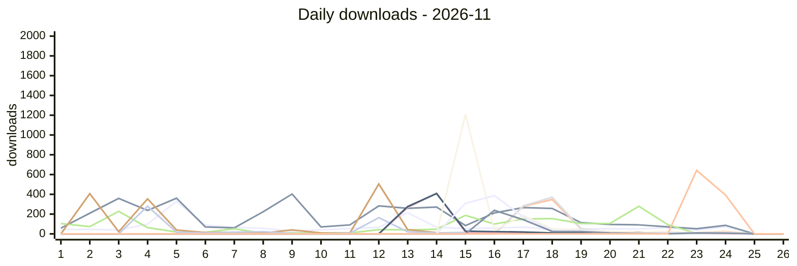
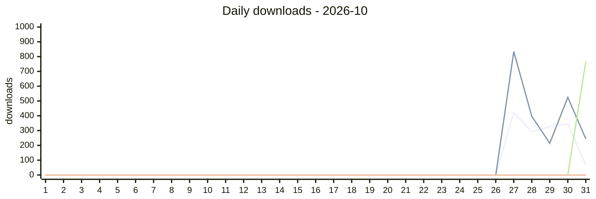

# NPM Downloads Tracker

Daily download counts for watched npm packages, fetched daily at 16:10 UTC (00:10 Beijing time) by GitHub Actions.
Days roll over at midnight Beijing time (UTC+8); npm per-day counts are UTC-day buckets, so the "today" row may stay 0 until the UTC day starts.
Download cells show `npm/npmmirror` — official registry.npmjs.org on the left, China mirror registry.npmmirror.com (taobao source) on the right; `—` means that source has no data. Charts, Avg/day, Peak, Trend and Est. real use npm counts only.

_Last updated: 2026-11-26 00:17 UTC_

## Watched packages

- `dsh-loop-recover`
- `dsh-rss-news-daily`
- `dsh-rss-news-flash-kuaixun`
- `dsh-rss-news-browser-fetch`
- `opencode-loop-recover`
- `oc-market-quail-zephyr-72a0`
- `awesome-opencode-market`
- `surfbird`
- `surfbird-mcp`
- `dsh-control-surfbird-for-kitesurf`
- `opencode-control-surfbird-for-kitesurf`
- `pi-control-surfbird-for-kitesurf`
- `awesome-skill-market`

## 2026-11 — month to date

| Package | Total | Est. real | Avg/day | Peak | Today | Trend |
| --- | ---: | ---: | ---: | ---: | ---: | ---: |
| `dsh-loop-recover` | 1,789/168 | 1,339 | 68.8 | 329 · 11-05 | 0/1 | ▂▂▁▃█▃▂▂▁▂▂▂▆▂▂▂▂▂▂▂▂▂▁▂▁▁ |
| `dsh-rss-news-daily` | 4,284/561 | 2,034 | 164.8 | 403 · 11-09 | 0/2 | ▂▅█▅█▂▂▅█▂▂▆▆▆▂▅▆▆▃▂▂▂▂▂▁▁ |
| `dsh-rss-news-flash-kuaixun` | 760/48 | 181 | 29.2 | 347 · 11-18 | 0/0 | ▁▁▁▁▁▁▁▁▁▁▁▁▁▁▁▁▇█▂▁▁▁▁▁▁▁ |
| `dsh-rss-news-browser-fetch` | 773/50 | 189 | 29.7 | 370 · 11-18 | 0/0 | ▁▁▁▁▁▁▁▁▁▁▁▁▁▁▁▁▇█▂▁▁▁▁▁▁▁ |
| `opencode-loop-recover` | 1,920/82 | 1,620 | 73.8 | 279 · 11-21 | 0/0 | ▄▃▇▂▁▁▂▁▁▁▁▂▂▂▆▃▅▅▄▄█▃▁▁▁▁ |
| `oc-market-quail-zephyr-72a0` | 1,540/79 | 383 | 59.2 | 505 · 11-12 | 0/0 | ▁▇▁▆▁▁▁▁▁▁▁█▁▁▁▁▁▁▁▁▁▁▁▁▁▁ |
| `awesome-opencode-market` | 633/31 | 203 | 24.3 | 280 · 11-04 | 0/0 | ▁▁▁█▁▁▁▁▁▁▁▅▁▁▁▁▁▁▁▁▁▁▁▁▁▁ |
| `surfbird` | 784/42 | 217 | 30.2 | 412 · 11-14 | 0/0 | ▁▁▁▁▁▁▁▁▁▁▁▁▆█▁▁▁▁▁▁▁▁▁▁▁▁ |
| `surfbird-mcp` | 835/40 | 259 | 32.1 | 408 · 11-14 | 0/0 | ▁▁▁▁▁▁▁▁▁▁▁▁▆█▁▁▁▁▁▁▁▁▁▁▁▁ |
| `dsh-control-surfbird-for-kitesurf` | 1,619/99 | 419 | 62.3 | 1,209 · 11-15 | 0/0 | ▁▁▁▁▁▁▁▁▁▁▁▁▁▁█▁▂▁▁▁▁▁▁▁▁▁ |
| `opencode-control-surfbird-for-kitesurf` | 980/45 | 230 | 37.7 | 387 · 11-16 | 0/0 | ▁▁▁▁▁▁▁▁▁▁▁▁▁▁▇█▄▁▁▁▁▁▁▁▁▁ |
| `pi-control-surfbird-for-kitesurf` | 464/76 | 82 | 17.8 | 238 · 11-16 | 0/0 | ▁▁▁▁▁▁▁▁▁▁▁▁▁▁▁█▅▁▁▁▁▁▁▁▁▁ |
| `awesome-skill-market` | 1,034/105 | 92 | 39.8 | 642 · 11-23 | 0/3 | ▁▁▁▁▁▁▁▁▁▁▁▁▁▁▁▁▁▁▁▁▁▁█▅▁▁ |

> `Est. real` subtracts ~150 automated downloads per version published that day — every `npm publish` triggers a scanner/mirror fetch wave. It's an upper bound on organic installs (ambient crawlers and CI can't be separated).

### Daily — 2026-11

| Package | **2026-11-26** | 2026-11-25 | 2026-11-24 | 2026-11-23 | 2026-11-22 | 2026-11-21 | 2026-11-20 | 2026-11-19 | 2026-11-18 | 2026-11-17 | 2026-11-16 | 2026-11-15 | 2026-11-14 | 2026-11-13 | 2026-11-12 | 2026-11-11 | 2026-11-10 | 2026-11-09 | 2026-11-08 | 2026-11-07 | 2026-11-06 | 2026-11-05 | 2026-11-04 | 2026-11-03 | 2026-11-02 | 2026-11-01 |
| --- | ---: | ---: | ---: | ---: | ---: | ---: | ---: | ---: | ---: | ---: | ---: | ---: | ---: | ---: | ---: | ---: | ---: | ---: | ---: | ---: | ---: | ---: | ---: | ---: | ---: | ---: |
| `dsh-loop-recover` | 0/1 | 0/2 | 72/3 | 39/3 | 63/2 | 51/4 | 53/2 | 48/3 | 46/3 | 69/9 | 59/8 | 53/6 | 67/15 | 214/15 | 66/4 | 54/8 | 42/4 | 27/2 | 56/5 | 66/16 | 88/28 | 329/10 | 99/4 | 39/1 | 46/9 | 43/1 |
| `dsh-rss-news-daily` | 0/2 | 0/5 | 87/4 | 52/6 | 71/35 | 91/1 | 96/33 | 113/47 | 257/31 | 266/32 | 212/76 | 84/9 | 271/26 | 258/42 | 283/20 | 91/6 | 70/11 | 403/18 | 224/20 | 61/28 | 70/17 | 361/16 | 237/15 | 359/37 | 209/4 | 58/20 |
| `dsh-rss-news-flash-kuaixun` | 0/0 | 0/2 | 24/3 | 11/0 | 9/7 | 19/0 | 21/6 | 50/9 | 347/21 | 279/0 | 0/0 | 0/0 | 0/0 | 0/0 | 0/0 | 0/0 | 0/0 | 0/0 | 0/0 | 0/0 | 0/0 | 0/0 | 0/0 | 0/0 | 0/0 | 0/0 |
| `dsh-rss-news-browser-fetch` | 0/0 | 0/0 | 17/0 | 5/0 | 7/2 | 17/0 | 20/6 | 53/8 | 370/34 | 284/0 | 0/0 | 0/0 | 0/0 | 0/0 | 0/0 | 0/0 | 0/0 | 0/0 | 0/0 | 0/0 | 0/0 | 0/0 | 0/0 | 0/0 | 0/0 | 0/0 |
| `opencode-loop-recover` | 0/0 | 0/0 | 15/0 | 4/0 | 93/0 | 279/0 | 106/0 | 105/0 | 155/1 | 151/0 | 100/7 | 187/33 | 47/0 | 41/0 | 43/0 | 10/2 | 11/1 | 10/0 | 6/0 | 52/0 | 16/0 | 19/1 | 63/11 | 228/11 | 74/0 | 105/15 |
| `oc-market-quail-zephyr-72a0` | 0/0 | 0/0 | 4/0 | 8/0 | 3/0 | 3/1 | 10/0 | 9/0 | 5/1 | 5/0 | 6/0 | 11/0 | 12/0 | 43/10 | 505/26 | 8/0 | 10/0 | 40/0 | 7/0 | 15/0 | 14/5 | 39/6 | 354/9 | 22/0 | 407/21 | 0/0 |
| `awesome-opencode-market` | 0/0 | 0/0 | 5/1 | 10/1 | 3/1 | 3/1 | 9/0 | 11/1 | 8/1 | 7/1 | 10/0 | 15/0 | 10/0 | 21/5 | 164/5 | 7/0 | 1/0 | 4/0 | 22/0 | 17/0 | 9/4 | 17/0 | 280/10 | 0/0 | 0/0 | 0/0 |
| `surfbird` | 0/0 | 0/0 | 3/0 | 6/0 | 11/1 | 11/0 | 10/0 | 6/0 | 8/1 | 15/0 | 19/0 | 16/4 | 412/36 | 267/0 | 0/0 | 0/0 | 0/0 | 0/0 | 0/0 | 0/0 | 0/0 | 0/0 | 0/0 | 0/0 | 0/0 | 0/0 |
| `surfbird-mcp` | 0/0 | 0/0 | 12/0 | 10/0 | 10/0 | 13/0 | 18/0 | 9/0 | 10/1 | 18/0 | 23/0 | 28/4 | 408/35 | 276/0 | 0/0 | 0/0 | 0/0 | 0/0 | 0/0 | 0/0 | 0/0 | 0/0 | 0/0 | 0/0 | 0/0 | 0/0 |
| `dsh-control-surfbird-for-kitesurf` | 0/0 | 0/0 | 17/0 | 10/0 | 27/0 | 13/1 | 27/0 | 38/8 | 53/3 | 186/5 | 39/10 | 1,209/72 | 0/0 | 0/0 | 0/0 | 0/0 | 0/0 | 0/0 | 0/0 | 0/0 | 0/0 | 0/0 | 0/0 | 0/0 | 0/0 | 0/0 |
| `opencode-control-surfbird-for-kitesurf` | 0/0 | 0/0 | 10/0 | 5/0 | 14/0 | 4/0 | 13/0 | 30/1 | 34/3 | 173/8 | 387/20 | 310/13 | 0/0 | 0/0 | 0/0 | 0/0 | 0/0 | 0/0 | 0/0 | 0/0 | 0/0 | 0/0 | 0/0 | 0/0 | 0/0 | 0/0 |
| `pi-control-surfbird-for-kitesurf` | 0/0 | 0/0 | 8/0 | 9/0 | 2/0 | 5/0 | 9/0 | 24/1 | 25/17 | 144/13 | 238/45 | 0/0 | 0/0 | 0/0 | 0/0 | 0/0 | 0/0 | 0/0 | 0/0 | 0/0 | 0/0 | 0/0 | 0/0 | 0/0 | 0/0 | 0/0 |
| `awesome-skill-market` | 0/3 | 0/26 | 392/76 | 642/0 | 0/0 | 0/0 | 0/0 | 0/0 | 0/0 | 0/0 | 0/0 | 0/0 | 0/0 | 0/0 | 0/0 | 0/0 | 0/0 | 0/0 | 0/0 | 0/0 | 0/0 | 0/0 | 0/0 | 0/0 | 0/0 | 0/0 |
| **Total** | 0/6 | 0/35 | 666/87 | 811/10 | 313/48 | 509/8 | 392/47 | 496/78 | 1,318/117 | 1,597/68 | 1,093/166 | 1,913/141 | 1,227/112 | 1,120/72 | 1,061/55 | 170/16 | 134/16 | 484/20 | 315/25 | 211/44 | 197/54 | 765/33 | 1,033/49 | 648/49 | 736/34 | 206/36 |
| Est. real | 0 | 0 | 366 | 169 | 313 | 509 | 392 | 496 | 568 | 440 | 405 | 413 | 477 | 277 | 311 | 170 | 134 | 184 | 165 | 211 | 197 | 165 | 303 | 198 | 179 | 206 |

## Docker Hub pulls

| Image | All-time pulls | 2026-11 est. | Today | Trend |
| --- | ---: | ---: | ---: | ---: |
| `terry2010/surfbird` | 1,118 | 1,118 | 16 | ▁▁▁▁▁▁▁▁▁▁▁▁██▂▁▁▁▁▆▁▂▁▁▄▁ |

> Docker Hub only exposes a cumulative `pull_count` — daily figures are diffs between once-a-day snapshots, so they lag ~1 day. `≈` marks days inside a missed-run gap or a new repo’s pre-tracking baseline (delta spread evenly). Same bot-wave caveat as npm: new tags get pulled by image scanners.

### Daily pulls — 2026-11

| Image | **2026-11-26** | 2026-11-25 | 2026-11-24 | 2026-11-23 | 2026-11-22 | 2026-11-21 | 2026-11-20 | 2026-11-19 | 2026-11-18 | 2026-11-17 | 2026-11-16 | 2026-11-15 | 2026-11-14 | 2026-11-13 | 2026-11-12 | 2026-11-11 | 2026-11-10 | 2026-11-09 | 2026-11-08 | 2026-11-07 | 2026-11-06 | 2026-11-05 | 2026-11-04 | 2026-11-03 | 2026-11-02 | 2026-11-01 |
| --- | ---: | ---: | ---: | ---: | ---: | ---: | ---: | ---: | ---: | ---: | ---: | ---: | ---: | ---: | ---: | ---: | ---: | ---: | ---: | ---: | ---: | ---: | ---: | ---: | ---: | ---: |
| `terry2010/surfbird` | 16 | 128 | 20 | 14 | 49 | 16 | 183 | 1 | 4 | 12 | 29 | 67 | ≈289 | ≈290 | — | — | — | — | — | — | — | — | — | — | — | — |
| **Total** | 16 | 128 | 20 | 14 | 49 | 16 | 183 | 1 | 4 | 12 | 29 | 67 | 289 | 290 | — | — | — | — | — | — | — | — | — | — | — | — |

## Monthly history

| Month | `dsh-loop-recover` | `dsh-rss-news-daily` | `dsh-rss-news-flash-kuaixun` | `dsh-rss-news-browser-fetch` | `opencode-loop-recover` | `oc-market-quail-zephyr-72a0` | `awesome-opencode-market` | `surfbird` | `surfbird-mcp` | `dsh-control-surfbird-for-kitesurf` | `opencode-control-surfbird-for-kitesurf` | `pi-control-surfbird-for-kitesurf` | `awesome-skill-market` | Grand total | Est. real |
| --- | ---: | ---: | ---: | ---: | ---: | ---: | ---: | ---: | ---: | ---: | ---: | ---: | ---: | ---: | ---: |
| 2026-10 | 1,453/117 | 2,214/119 | 0/0 | 0/0 | 767/33 | 0/0 | 0/0 | 0/0 | 0/0 | 0/0 | 0/0 | 0/0 | 0/0 | 4,434/269 | 487 |
| 2026-11 (MTD) | 1,789/168 | 4,284/561 | 760/48 | 773/50 | 1,920/82 | 1,540/79 | 633/31 | 784/42 | 835/40 | 1,619/99 | 980/45 | 464/76 | 1,034/105 | 17,415/1,426 | 7,248 |

Daily downloads — 2026-10

| Package | 2026-10-31 | 2026-10-30 | 2026-10-29 | 2026-10-28 | 2026-10-27 | 2026-10-26 | 2026-10-25 | 2026-10-24 | 2026-10-23 | 2026-10-22 | 2026-10-21 | 2026-10-20 | 2026-10-19 | 2026-10-18 | 2026-10-17 | 2026-10-16 | 2026-10-15 | 2026-10-14 | 2026-10-13 | 2026-10-12 | 2026-10-11 | 2026-10-10 | 2026-10-09 | 2026-10-08 | 2026-10-07 | 2026-10-06 | 2026-10-05 | 2026-10-04 | 2026-10-03 | 2026-10-02 | 2026-10-01 |
| --- | ---: | ---: | ---: | ---: | ---: | ---: | ---: | ---: | ---: | ---: | ---: | ---: | ---: | ---: | ---: | ---: | ---: | ---: | ---: | ---: | ---: | ---: | ---: | ---: | ---: | ---: | ---: | ---: | ---: | ---: | ---: |
| `dsh-loop-recover` | 68/35 | 346/29 | 326/8 | 291/45 | 422/0 | 0/0 | 0/0 | 0/0 | 0/0 | 0/0 | 0/0 | 0/0 | 0/0 | 0/0 | 0/0 | 0/0 | 0/0 | 0/0 | 0/0 | 0/0 | 0/0 | 0/0 | 0/0 | 0/0 | 0/0 | 0/0 | 0/0 | 0/0 | 0/0 | 0/0 | 0/0 |
| `dsh-rss-news-daily` | 244/26 | 525/19 | 214/9 | 397/65 | 834/0 | 0/0 | 0/0 | 0/0 | 0/0 | 0/0 | 0/0 | 0/0 | 0/0 | 0/0 | 0/0 | 0/0 | 0/0 | 0/0 | 0/0 | 0/0 | 0/0 | 0/0 | 0/0 | 0/0 | 0/0 | 0/0 | 0/0 | 0/0 | 0/0 | 0/0 | 0/0 |
| `dsh-rss-news-flash-kuaixun` | 0/0 | 0/0 | 0/0 | 0/0 | 0/0 | 0/0 | 0/0 | 0/0 | 0/0 | 0/0 | 0/0 | 0/0 | 0/0 | 0/0 | 0/0 | 0/0 | 0/0 | 0/0 | 0/0 | 0/0 | 0/0 | 0/0 | 0/0 | 0/0 | 0/0 | 0/0 | 0/0 | 0/0 | 0/0 | 0/0 | 0/0 |
| `dsh-rss-news-browser-fetch` | 0/0 | 0/0 | 0/0 | 0/0 | 0/0 | 0/0 | 0/0 | 0/0 | 0/0 | 0/0 | 0/0 | 0/0 | 0/0 | 0/0 | 0/0 | 0/0 | 0/0 | 0/0 | 0/0 | 0/0 | 0/0 | 0/0 | 0/0 | 0/0 | 0/0 | 0/0 | 0/0 | 0/0 | 0/0 | 0/0 | 0/0 |
| `opencode-loop-recover` | 767/33 | 0/0 | 0/0 | 0/0 | 0/0 | 0/0 | 0/0 | 0/0 | 0/0 | 0/0 | 0/0 | 0/0 | 0/0 | 0/0 | 0/0 | 0/0 | 0/0 | 0/0 | 0/0 | 0/0 | 0/0 | 0/0 | 0/0 | 0/0 | 0/0 | 0/0 | 0/0 | 0/0 | 0/0 | 0/0 | 0/0 |
| `oc-market-quail-zephyr-72a0` | 0/0 | 0/0 | 0/0 | 0/0 | 0/0 | 0/0 | 0/0 | 0/0 | 0/0 | 0/0 | 0/0 | 0/0 | 0/0 | 0/0 | 0/0 | 0/0 | 0/0 | 0/0 | 0/0 | 0/0 | 0/0 | 0/0 | 0/0 | 0/0 | 0/0 | 0/0 | 0/0 | 0/0 | 0/0 | 0/0 | 0/0 |
| `awesome-opencode-market` | 0/0 | 0/0 | 0/0 | 0/0 | 0/0 | 0/0 | 0/0 | 0/0 | 0/0 | 0/0 | 0/0 | 0/0 | 0/0 | 0/0 | 0/0 | 0/0 | 0/0 | 0/0 | 0/0 | 0/0 | 0/0 | 0/0 | 0/0 | 0/0 | 0/0 | 0/0 | 0/0 | 0/0 | 0/0 | 0/0 | 0/0 |
| `surfbird` | 0/0 | 0/0 | 0/0 | 0/0 | 0/0 | 0/0 | 0/0 | 0/0 | 0/0 | 0/0 | 0/0 | 0/0 | 0/0 | 0/0 | 0/0 | 0/0 | 0/0 | 0/0 | 0/0 | 0/0 | 0/0 | 0/0 | 0/0 | 0/0 | 0/0 | 0/0 | 0/0 | 0/0 | 0/0 | 0/0 | 0/0 |
| `surfbird-mcp` | 0/0 | 0/0 | 0/0 | 0/0 | 0/0 | 0/0 | 0/0 | 0/0 | 0/0 | 0/0 | 0/0 | 0/0 | 0/0 | 0/0 | 0/0 | 0/0 | 0/0 | 0/0 | 0/0 | 0/0 | 0/0 | 0/0 | 0/0 | 0/0 | 0/0 | 0/0 | 0/0 | 0/0 | 0/0 | 0/0 | 0/0 |
| `dsh-control-surfbird-for-kitesurf` | 0/0 | 0/0 | 0/0 | 0/0 | 0/0 | 0/0 | 0/0 | 0/0 | 0/0 | 0/0 | 0/0 | 0/0 | 0/0 | 0/0 | 0/0 | 0/0 | 0/0 | 0/0 | 0/0 | 0/0 | 0/0 | 0/0 | 0/0 | 0/0 | 0/0 | 0/0 | 0/0 | 0/0 | 0/0 | 0/0 | 0/0 |
| `opencode-control-surfbird-for-kitesurf` | 0/0 | 0/0 | 0/0 | 0/0 | 0/0 | 0/0 | 0/0 | 0/0 | 0/0 | 0/0 | 0/0 | 0/0 | 0/0 | 0/0 | 0/0 | 0/0 | 0/0 | 0/0 | 0/0 | 0/0 | 0/0 | 0/0 | 0/0 | 0/0 | 0/0 | 0/0 | 0/0 | 0/0 | 0/0 | 0/0 | 0/0 |
| `pi-control-surfbird-for-kitesurf` | 0/0 | 0/0 | 0/0 | 0/0 | 0/0 | 0/0 | 0/0 | 0/0 | 0/0 | 0/0 | 0/0 | 0/0 | 0/0 | 0/0 | 0/0 | 0/0 | 0/0 | 0/0 | 0/0 | 0/0 | 0/0 | 0/0 | 0/0 | 0/0 | 0/0 | 0/0 | 0/0 | 0/0 | 0/0 | 0/0 | 0/0 |
| `awesome-skill-market` | 0/0 | 0/0 | 0/0 | 0/0 | 0/0 | 0/0 | 0/0 | 0/0 | 0/0 | 0/0 | 0/0 | 0/0 | 0/0 | 0/0 | 0/0 | 0/0 | 0/0 | 0/0 | 0/0 | 0/0 | 0/0 | 0/0 | 0/0 | 0/0 | 0/0 | 0/0 | 0/0 | 0/0 | 0/0 | 0/0 | 0/0 |
| **Total** | 1,079/94 | 871/48 | 540/17 | 688/110 | 1,256/0 | 0/0 | 0/0 | 0/0 | 0/0 | 0/0 | 0/0 | 0/0 | 0/0 | 0/0 | 0/0 | 0/0 | 0/0 | 0/0 | 0/0 | 0/0 | 0/0 | 0/0 | 0/0 | 0/0 | 0/0 | 0/0 | 0/0 | 0/0 | 0/0 | 0/0 | 0/0 |
| Est. real | 179 | 121 | 90 | 97 | 0 | 0 | 0 | 0 | 0 | 0 | 0 | 0 | 0 | 0 | 0 | 0 | 0 | 0 | 0 | 0 | 0 | 0 | 0 | 0 | 0 | 0 | 0 | 0 | 0 | 0 | 0 |

---

_Generated by `scripts/update.mjs` — raw data in `data/`_
